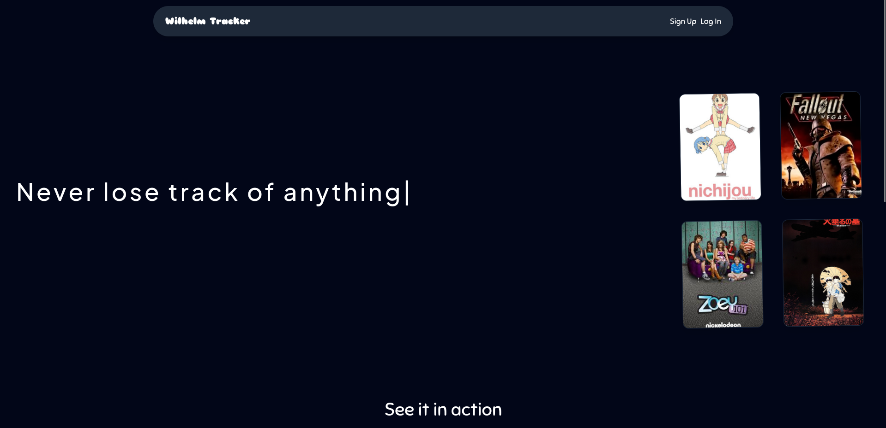
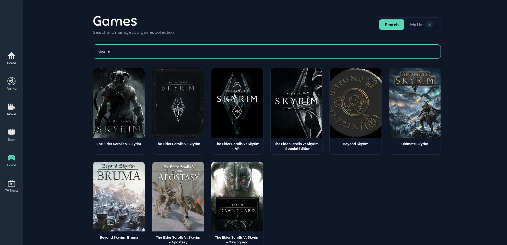
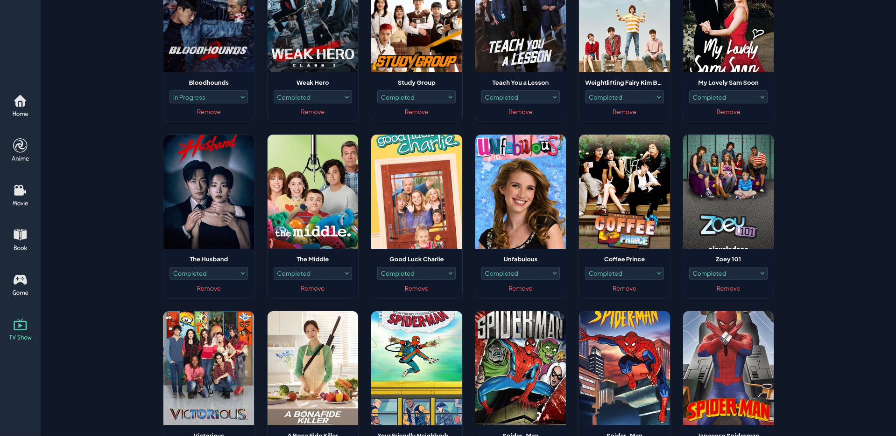
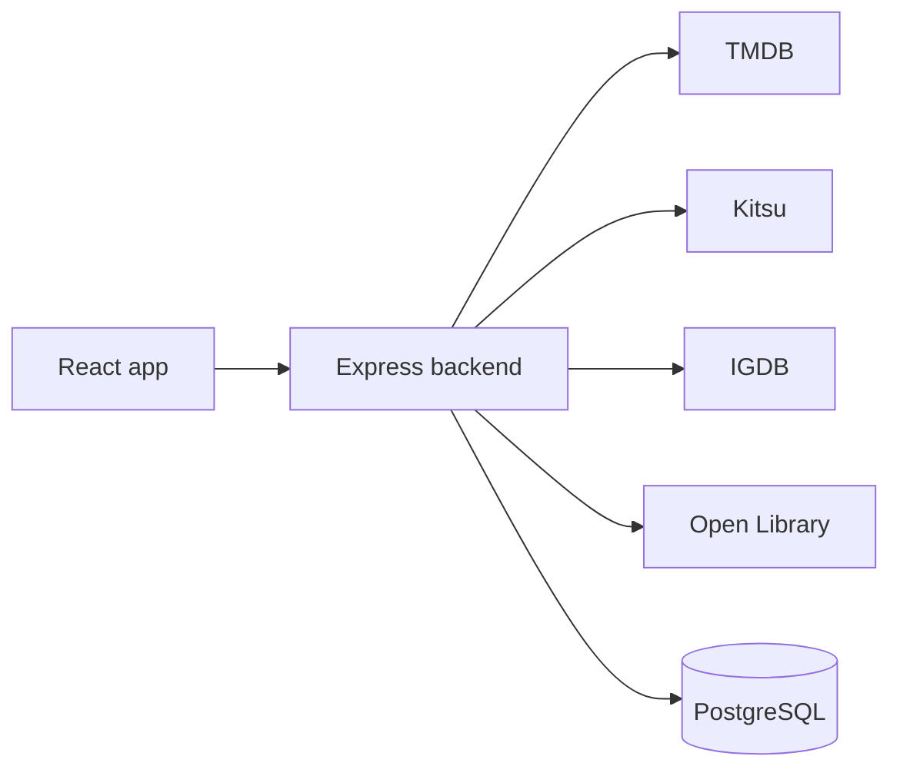

# Wilhelm Tracker

A simple, private media tracker for movies, TV shows, anime, games and books, all in one place.

**Live demo:** https://wilhelm-tracker.vercel.app





## Why I built it

Most trackers I found cover only one type of media, and many are built around social features such as reviews and discussion. I wanted a simple personal tracker for everything I watch, play and read, with no social layer.

## Features

- Search movies, TV shows, anime, games and books from a single search bar
- Add any result to your personal list, with duplicate entries prevented at the database level
- Debounced search, so the app doesn't send a request on every keystroke
- Sign up and log in with JWT authentication; passwords are hashed with bcrypt
- Protected routes on both the frontend and the backend

## Tech stack

| Layer | Technology |
|---|---|
| Frontend | React |
| Backend | Node.js, Express |
| Database | PostgreSQL (hosted on Supabase) |
| Auth | JWT, bcrypt |
| External APIs | TMDB (movies, TV), Kitsu (anime), IGDB (games), Open Library (books) |
| Hosting | Vercel (frontend), Render (backend), Supabase (database) |

## Architecture

The browser never calls the external APIs directly. All requests go through the Express backend (a backend-for-frontend layer), which keeps API keys on the server and converts each API's response into one common format.



## Engineering notes

- **Four APIs, one format.** Each API has its own authentication method and response shape. The backend maps them all to one structure, so every media type is stored in a single schema.
- **IGDB authentication.** IGDB uses Twitch OAuth, and its access tokens expire. The backend refreshes the token automatically, so searches no longer fail silently.
- **No duplicate list entries.** The list table has a composite `UNIQUE (user_id, media_id)` constraint, so one user can't add the same item twice, while different users can add the same title.
- **Deployment bugs I fixed.** Case-sensitive file paths that worked locally but failed on the Linux build, and snake_case column names from Postgres not matching camelCase in JavaScript.

## Getting started

### Prerequisites

- Node.js 18 or higher
- A PostgreSQL database (local or Supabase)
- API keys for TMDB and IGDB (Twitch client ID and secret). Kitsu and Open Library don't need keys.

### Installation

```bash
git clone https://github.com/Arshad9748/Media-Tracker.git
cd Media-Tracker
```

**Backend**

```bash
cd server
npm install
```

Create a `.env` file:

```env
DB_USER =  your_user_name
DB_HOST =  localhost
DB_NAME =  database_name
DB_PASSWORD = database_password
DB_PORT = database_port
JWT_SECRET = secret_key
TMDB_API_KEY = api_key
TWITCH_CLIENT_ID= twitch_client_id
TWITCH_CLIENT_SECRET= twitch_client_secret
```

Start the server:

```bash
npm run dev
```

**Frontend**

```bash
cd client
npm install
npm run dev
```

### Database

Create the tables with the SQL. The main tables are users and the media list, where the list has a unique constraint on `(user_id, media_id)`.

## Project structure

```
.
├── client
│   ├── dist
│   ├── eslint.config.js
│   ├── index.html
│   ├── node_modules
│   ├── package.json
│   ├── package-lock.json
│   ├── public
│   ├── README.md
│   ├── src
│   ├── vercel.json
│   └── vite.config.js
├── docs
│   ├── wilhelmLanding.png
│   ├── wilhelmList.png
│   └── wilhelmSearch.png
├── server
│   ├── config
│   ├── controllers
│   ├── index.js
│   ├── middleware
│   ├── node_modules
│   ├── package.json
│   ├── package-lock.json
│   └── routes
└── Wilhelm-Tracker-README.md
```

## Roadmap

- Move the JWT from localStorage to an HTTP-only cookie, with the CORS and CSRF settings that requires
- Add rate limiting and input validation on the API
- Automated tests: Jest and Supertest for the API, React Testing Library for components
- Ratings, a detail page for each title, and genre filtering

## License

MIT. See [LICENSE](./LICENSE).

## Author

Arshad Murtaza Ahmed: [LinkedIn](https://www.linkedin.com/in/arshad-murtaza-ahmed/) · [GitHub](https://github.com/Arshad9748)
